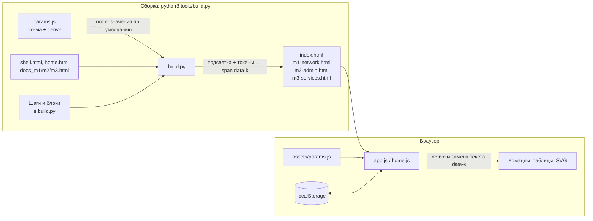

# Сайт учебного стенда au-team.irpo — техническая документация

> Версия документа: 1.4 · Состояние сайта: главная страница; Модули 1–3 · Автор стенда: Панков С. А., НовГУ

## Содержание

1. [Назначение](#1-назначение)
2. [Возможности](#2-возможности)
3. [Структура репозитория и именование файлов](#3-структура-репозитория-и-именование-файлов)
4. [Архитектура](#4-архитектура)
5. [Система параметров](#5-система-параметров)
6. [Токены подстановки](#6-токены-подстановки)
7. [Сборщик `tools/build.py`](#7-сборщик-toolsbuildpy)
8. [Клиентская логика `assets/app.js`](#8-клиентская-логика-assetsappjs)
9. [Оформление `assets/style.css`](#9-оформление-assetsstylecss)
10. [Содержание страниц](#10-содержание-страниц)
11. [Как вносить изменения](#11-как-вносить-изменения)
12. [Тестирование](#12-тестирование)
13. [Публикация](#13-публикация)
14. [Данные пользователя и приватность](#14-данные-пользователя-и-приватность)
15. [Совместимость](#15-совместимость)
16. [Известные ограничения и риски](#16-известные-ограничения-и-риски)
17. [План развития](#17-план-развития)
18. [История изменений](#18-история-изменений)

---

## 1. Назначение

Статический сайт-шпаргалка для демонстрационного экзамена по специальности **09.02.06 «Сетевое и системное администрирование»** (КИМ 09.02.06-1-2027, профильный уровень). Он объединяет:

- **документацию сети** учебного стенда: топологию, адресацию, VLAN, службы, учётные записи, DNS-записи;
- **команды настройки** для ALT Linux (etcnet, FRR, nftables, ISC DHCP, BIND и др.) в порядке пунктов заданий КИМ, с копированием в один клик;
- **подстановку параметров**: пользователь меняет адреса, интерфейсы, VLAN, пароли, и все команды, таблицы и схема пересобираются в браузере.

Сайт публикуется на GitHub Pages и не требует сервера: всё работает в браузере.

**Целевая аудитория:** студенты, готовящиеся к ДЭ, и преподаватели, разворачивающие стенд.

**Исходный стенд:** 6 ВМ VirtualBox — ISP, HQ-RTR, HQ-SRV, HQ-CLI, BR-RTR, BR-SRV. Все на ALT Server 11.1, кроме HQ-CLI на ALT Workstation 11.2. У каждой ВМ `enp0s3` — NAT, `enp0s8` — Host-Only 192.168.56.0/24 для управления, остальные адаптеры — внутренние сети стенда.

---

## 2. Возможности

| Область | Функция |
|---|---|
| Главная | Карточки трёх модулей с прогрессом из браузера, «Как пользоваться», занятия паспорта ↔ шаги сайта ↔ снапшоты, состав стенда |
| Документация | Схема сети в SVG (широкая и вертикальная для телефона), таблицы ВМ, адресации, VLAN, служб, DNS; проверка соответствия размерам сетей из КИМ |
| Команды | Блоки по шагам КИМ с метками ВМ; подсветка синтаксиса; копирование блока; сворачивание длинных блоков |
| Параметры | Панель «⚙ Параметры сети»: 62 параметра в 9 группах, проверка значений и согласованности подсетей, пресет «Маски по КИМ», экспорт и импорт JSON, пересборка по кнопке |
| Навигация | Боковое меню с подсветкой текущего раздела, переключатель «Главная · М1 · М2 · М3», ссылки «← / →» на соседние модули, фильтр по ВМ, поиск по командам; старые адреса переадресуются |
| Прогресс | Отметки «готово» у блоков, счётчики по шагам, общая полоса прогресса |
| Выгрузка | «Скопировать всё» и «Скачать .sh» с командами выбранной ВМ |
| Прочее | Версия для печати, адаптивная вёрстка, превью ссылок (Open Graph), иконка сайта |

---

## 3. Структура репозитория и именование файлов

```
/                          ← корень репозитория = корень сайта на GitHub Pages
├── index.html             главная страница (генерируется)
├── m1-network.html        Модуль 1 · Настройка сетевой инфраструктуры (генерируется)
├── m2-admin.html          Модуль 2 · Организация сетевого администрирования (генерируется)
├── m3-services.html       Модуль 3 · Эксплуатация объектов сетевой инфраструктуры (генерируется)
├── module2.html           переадресация со старого адреса на m2-admin.html (генерируется)
├── 404.html               «страница не найдена» + переадресация module1/3.html (генерируется)
├── README.md              краткое описание и публикация
├── DOCUMENTATION.md       этот документ
├── .nojekyll              отключает обработку Jekyll (необязателен)
├── assets/
│   ├── style.css          оформление (копия tools/src/style.css)
│   ├── app.js             интерфейс страниц модулей (копия tools/src/app.js)
│   ├── home.js            интерфейс главной (копия tools/src/home.js)
│   ├── params.js          схема параметров (копия tools/src/params.js)
│   ├── logo.webp          логотип 360×319
│   ├── favicon.png        иконка 180×180
│   └── og-image.png       превью ссылок 1200×630
└── tools/                 исходники (на работу сайта не влияют)
    ├── build.py           сборщик страниц
    ├── src/
    │   ├── params.js      схема параметров, проверка, вычисление производных
    │   ├── app.js         клиентская логика страниц модулей
    │   ├── home.js        клиентская логика главной
    │   ├── style.css      стили
    │   ├── shell.html     каркас страницы модуля
    │   ├── home.html      каркас главной
    │   ├── docs_m1.html   документация Модуля 1 (таблицы + 2 SVG)
    │   ├── docs_m2.html   вводная часть Модуля 2
    │   └── docs_m3.html   вводная часть Модуля 3
    └── tests/
        ├── check_bash.py  синтаксис всех блоков (bash -n)
        └── test_site.mjs  сквозной тест интерфейса (Playwright)
```

> **Важно.** Все `*.html` в корне и файлы `assets/{style.css,app.js,home.js,params.js}` — результат сборки. Правьте исходники в `tools/src/` и `tools/build.py`, затем пересобирайте. Ручные правки сгенерированных файлов затрутся при следующей сборке.

### 3.1. Правила именования

| Что | Шаблон | Пример | Почему так |
|---|---|---|---|
| Главная | `index.html` | `index.html` | GitHub Pages открывает её по адресу сайта без имени файла |
| Страница модуля | `m<N>-<тема>.html` | `m3-services.html` | `m<N>` = номер модуля КИМ = `PAGE_ID` = суффикс ключа отметок `stand.done.v1.m<N>`; при сортировке по имени файлы идут в порядке модулей; тема — одно английское слово в нижнем регистре, без пробелов и кириллицы (безопасно для URL) |
| Каркас страницы | `tools/src/<роль>.html` | `shell.html`, `home.html` | один каркас на тип страницы |
| Вводная часть модуля | `tools/src/docs_m<N>.html` | `docs_m3.html` | тот же номер, что и у страницы |
| Скрипт ВМ (скачивание) | `<вм>.sh`, `<вм>-m<N>.sh` | `hq-srv-m3.sh` | для Модуля 1 без суффикса, как раньше |
| Якорь шага | `t<пункт>` (М1), `m<N>t<пункт>` (М2, М3), служебные — словом | `t5`, `m3t4`, `prep`, `check` | номер пункта КИМ читается из адреса; id не меняются, к ним привязаны отметки |
| Якорь блока | `<якорь шага>-<номер>` | `m3t4-2` | порядковый номер блока в шаге |
| Старое имя | запись в `LEGACY` в `build.py` | `module2.html → m2-admin.html` | сборщик создаёт страницу-переадресацию с сохранением `#якоря` |

Таблица страниц задаётся в одном месте — список `PAGES` в `build.py` (`pid`, `file`, `num`, `name`, шаги, вводная часть, оглавление, описание карточки). Из него строятся переключатель разделов, ссылки «← / →», карточки главной и 404.

**Совместимость со старыми адресами (до v1.4).** `index.html` раньше был Модулем 1: главная содержит карту якорей Модуля 1, и ссылка вида `index.html#t5` сразу переадресуется на `m1-network.html#t5`. `module2.html` — страница-переадресация на `m2-admin.html` с сохранением якоря. `404.html` переводит `module1.html` / `module3.html` на новые имена. Отметки «готово» и параметры не теряются: ключи `localStorage` не изменились.

---

## 4. Архитектура

Сайт сочетает **статическую генерацию** при сборке и **подстановку значений** в браузере.



**Принципы:**

1. **Один источник истины для параметров** — `params.js`. Его использует и сборщик (через Node, чтобы заполнить HTML значениями по умолчанию), и браузер (чтобы пересобирать команды). Логика вычислений не дублируется.
2. **HTML сразу содержит значения по умолчанию.** Страница читается и печатается даже с отключённым JavaScript.
3. **Пересборка — это замена текста**, а не перерисовка: каждое подставляемое значение обёрнуто в `<span class="v" data-k="КЛЮЧ">` (в SVG — `<tspan>`). `app.js` вычисляет все значения и обновляет `textContent`. Подсветка синтаксиса сохраняется.
4. **Копирование берёт `textContent`** блока, поэтому в буфер всегда попадают текущие значения.
5. **Никаких внешних зависимостей во время работы**: нет CDN, шрифтов из сети, фреймворков. Шрифты системные.

---

## 5. Система параметров

### 5.1. Формат схемы

Файл `tools/src/params.js` (UMD-модуль: `window.NET` в браузере, `module.exports` в Node).

```js
var GROUPS = [
  { id: "common", title: "Общие", fields: [
    ["DOMAIN", "Домен", "au-team.irpo", "host"],   // [ключ, подпись, по умолчанию, тип]
    ...
  ]},
  ...
];
```

API модуля (параметров — 62, значений после `derive()` — 152):

| Функция / поле | Назначение |
|---|---|
| `GROUPS`, `FIELDS` | Схема по группам и плоский словарь `{key: {key,label,def,type,group}}` |
| `defaults()` | Объект значений по умолчанию |
| `validate(p)` | `{errors:{key:msg}, global:[...], warnings:[...]}` — проверка полей и согласованности |
| `derive(p)` | Все значения для подстановки: исходные + производные (144 ключа) |
| `kim(p)` | Список проверок соответствия размерам сетей из КИМ `[[текст, ok, значение]]` |
| `KIM_PRESET` | Набор значений для кнопки «Маски по КИМ» |

### 5.2. Типы и проверка

| Тип | Правило |
|---|---|
| `ip` | IPv4, октеты 0–255 |
| `cidr` | `IPv4/префикс`, префикс 1–30 |
| `pfx` | Число 1–30 |
| `if` | Имя интерфейса: `[A-Za-z0-9_.:-]`, до 15 символов |
| `vlan` | 1–4094 |
| `port` | 1–65535 |
| `int` | 1–60000 |
| `mac` | `xx:xx:xx:xx:xx:xx` |
| `host` | Доменное имя минимум из двух меток |
| `path` | Абсолютный путь `/dev/sdb` |
| `text` | Непустой, без `'`, `"`, `` ` ``, `$`, `\` — защита от поломки кавычек в командах |

### 5.3. Параметры

**Общие**

| Ключ | Описание | По умолчанию | Тип |
|---|---|---|---|
| `DOMAIN` | Домен | `au-team.irpo` | host |
| `PW` | Пароль (учётки, OSPF, БД) | `P@ssw0rd` | text |
| `TZ` | Часовой пояс | `Europe/Moscow` | text |
| `DNS_FWD` | DNS пересылки | `77.88.8.7` | ip |
| `SSH_PORT` | Порт SSH | `2027` | port |
| `SSH_UID` | UID sshuser | `2027` | int |
| `BANNER` | Баннер SSH | `Authorized access only` | text |

**VLAN**

| Ключ | Описание | По умолчанию | Тип |
|---|---|---|---|
| `V_SRV` | VLAN серверов | `100` | vlan |
| `V_CLI` | VLAN клиентов | `200` | vlan |
| `V_MGMT` | VLAN управления | `999` | vlan |

**ISP**

| Ключ | Описание | По умолчанию | Тип |
|---|---|---|---|
| `ISP_WAN` | Интерфейс в Интернет (DHCP) | `enp0s3` | if |
| `ISP_HQ_IF` | Интерфейс к HQ-RTR | `enp0s9` | if |
| `ISP_HQ` | Адрес к HQ-RTR | `172.16.1.1/28` | cidr |
| `ISP_BR_IF` | Интерфейс к BR-RTR | `enp0s10` | if |
| `ISP_BR` | Адрес к BR-RTR | `172.16.2.1/28` | cidr |

**HQ-RTR**

| Ключ | Описание | По умолчанию | Тип |
|---|---|---|---|
| `HQ_WAN_IF` | Интерфейс к ISP | `enp0s10` | if |
| `HQ_WAN_IP` | Адрес к ISP | `172.16.1.2` | ip |
| `HQ_LAN_IF` | Trunk-интерфейс | `enp0s9` | if |
| `HQ_GW_SRV` | Шлюз VLAN серверов | `10.0.100.1/24` | cidr |
| `HQ_GW_CLI` | Шлюз VLAN клиентов | `10.0.200.1/24` | cidr |
| `HQ_GW_MGMT` | Шлюз VLAN управления | `10.0.99.1/24` | cidr |
| `GRE_HQ` | Адрес gre1 | `10.10.10.1/30` | cidr |

**HQ-SRV / HQ-CLI / DHCP**

| Ключ | Описание | По умолчанию | Тип |
|---|---|---|---|
| `HQ_SRV_IF` | HQ-SRV: интерфейс | `enp0s9` | if |
| `HQ_SRV_IP` | HQ-SRV: адрес | `10.0.100.20` | ip |
| `HQ_CLI_IF` | HQ-CLI: интерфейс | `enp0s9` | if |
| `HQ_CLI_IP` | HQ-CLI: адрес (резерв) | `10.0.200.30` | ip |
| `HQ_CLI_MAC` | HQ-CLI: MAC | `08:00:27:ee:f2:7c` | mac |
| `DHCP_FROM` | Пул DHCP: от | `10.0.200.50` | ip |
| `DHCP_TO` | Пул DHCP: до | `10.0.200.150` | ip |

**BR-RTR / BR-SRV**

| Ключ | Описание | По умолчанию | Тип |
|---|---|---|---|
| `BR_WAN_IF` | BR-RTR: интерфейс к ISP | `enp0s9` | if |
| `BR_WAN_IP` | BR-RTR: адрес к ISP | `172.16.2.2` | ip |
| `BR_LAN_IF` | BR-RTR: trunk-интерфейс | `enp0s10` | if |
| `BR_GW_SRV` | BR-RTR: шлюз VLAN серверов | `10.1.100.17/28` | cidr |
| `BR_GW_MGMT` | BR-RTR: шлюз VLAN управления | `10.1.99.1/28` | cidr |
| `GRE_BR` | BR-RTR: адрес gre1 | `10.10.10.2` | ip |
| `BR_SRV_IF` | BR-SRV: интерфейс | `enp0s9` | if |
| `BR_SRV_IP` | BR-SRV: адрес | `10.1.100.20` | ip |
| `BR_FW_IP` | BR-FW: адрес (для DNS) | `10.1.99.2` | ip |

**Сеть управления (Host-Only)**

| Ключ | Описание | По умолчанию | Тип |
|---|---|---|---|
| `MG_IF` | Интерфейс | `enp0s8` | if |
| `MG_PFX` | Префикс | `24` | pfx |
| `MG_ISP` | ISP | `192.168.56.40` | ip |
| `MG_HQRTR` | HQ-RTR | `192.168.56.10` | ip |
| `MG_HQSRV` | HQ-SRV | `192.168.56.20` | ip |
| `MG_HQCLI` | HQ-CLI | `192.168.56.30` | ip |
| `MG_BRRTR` | BR-RTR | `192.168.56.50` | ip |
| `MG_BRSRV` | BR-SRV | `192.168.56.60` | ip |

**Модуль 2**

| Ключ | Описание | По умолчанию | Тип |
|---|---|---|---|
| `RAID_D1` | HQ-SRV: диск 1 для RAID | `/dev/sdb` | path |
| `RAID_D2` | HQ-SRV: диск 2 для RAID | `/dev/sdc` | path |
| `ISO_DEV` | Привод с Additional.iso | `/dev/sr0` | path |
| `ISO_DIR` | Каталог с файлами Additional.iso (если пуст — туда монтируется `ISO_DEV`) | `/opt/additional` | path |
| `NTP_UP` | Вышестоящий NTP для ISP | `ntp1.vniiftri.ru` | host |
| `HQ_USERS` | Число пользователей hquser | `5` | int |
| `HQ_USER_PW` | Пароль hquserN — к значению дописывается номер (`Passw0rd!1`…) | `Passw0rd!` | text |
| `ANS_PORT` | Порт SSH HQ-CLI и маршрутизаторов (инвентарь Ansible) | `2027` | port |
| `APP_PORT` | Порт testapp на BR-SRV | `8080` | port |
| `WEB_PORT` | Порт apache на HQ-SRV | `80` | port |
| `EXT_PORT` | Внешний порт веб-приложений | `8080` | port |

**Модуль 3** (v1.4)

| Ключ | Описание | По умолчанию | Тип |
|---|---|---|---|
| `WEB_USER` | Пользователь web-аутентификации (Basic Auth на ISP) | `WEB` | text |
| `CA_DAYS` | Срок действия сертификатов ЦС, дней | `30` | int |
| `ATOP_INT` | Интервал записи atop, секунд (7 минут) | `420` | int |
| `F2B_RETRY` | fail2ban: неудачных попыток до блокировки | `3` | int |
| `F2B_BAN` | fail2ban: время блокировки, секунд | `60` | int |

### 5.4. Производные значения (`derive`)

Для каждого параметра типа **`cidr`** с ключом `K` вычисляются:

| Ключ | Пример для `HQ_GW_SRV = 10.0.100.1/24` |
|---|---|
| `K_IP` | `10.0.100.1` |
| `K_PFX` | `24` |
| `K_NET` | `10.0.100.0` |
| `K_MASK` | `255.255.255.0` |
| `K_SUBNET` | `10.0.100.0/24` |
| `K_DOT` | `.1` (последний октет — для подписей на схеме) |

Для параметров типа **`ip`**: `K_DOT`.

Составные значения:

| Ключ | Формула |
|---|---|
| `HQ_WAN_CIDR`, `BR_WAN_CIDR` | адрес маршрутизатора + префикс сети ISP |
| `GRE_BR_CIDR` | `GRE_BR` + префикс `GRE_HQ` |
| `HQ_SRV_CIDR`, `HQ_CLI_CIDR`, `BR_SRV_CIDR` | адрес хоста + префикс шлюза его VLAN |
| `MG_<ВМ>_CIDR` | адрес управления + `MG_PFX` |
| `REV_HQ`, `REV_BR` | обратная зона по первым трём октетам адреса сервера: `100.0.10.in-addr.arpa` |
| `REV_HQ_FILE`, `REV_BR_FILE` | имя файла зоны: `10.0.100.rev` |
| `REV_HQ_PTR`, `REV_BR_PTR` | последний октет для PTR |
| `REALM` | `DOMAIN` в верхнем регистре (`AU-TEAM.IRPO`) |
| `WG` | первая метка домена в верхнем регистре (`AU-TEAM`) |
| `H_ISP`, `H_HQRTR`, `H_BRRTR`, `H_HQSRV`, `H_BRSRV`, `H_HQCLI` | FQDN: `hq-rtr.<DOMAIN>` и т. д. |

### 5.5. Проверка согласованности

Ошибки, которые **блокируют** пересборку:

- адрес HQ-RTR/BR-RTR к ISP не входит в сеть ISP;
- адрес gre1 BR-RTR не входит в сеть туннеля;
- HQ-SRV, HQ-CLI, BR-SRV не входят в сеть своего VLAN;
- пул DHCP вне сети клиентов, начало пула больше конца, адрес маршрутизатора внутри пула;
- номера VLAN совпадают.

**Предупреждения** (пересборка разрешена):

- резерв HQ-CLI попадает в пул DHCP;
- маска VLAN серверов короче /24 — обратные зоны строятся по трём октетам и требуют ручной проверки.

### 5.6. Соответствие КИМ и пресет

`kim(p)` проверяет: VLAN серверов ≤ 32 адресов (/27), VLAN клиентов ≤ 16 (/28), VLAN управления ≤ 8 (/29), сеть BR-SRV ≤ 16 (/28), туннель /30, сети ISP /28. Результат выводится в блок «Соответствие размерам сетей из КИМ» и пересчитывается при каждой пересборке.

`KIM_PRESET` подставляет: `10.0.100.1/27`, `10.0.200.1/28` (HQ-CLI `.14`, пул `.2–.13`), `10.0.99.1/29`, BR `10.1.100.17/28` (BR-SRV `.20`, сеть `10.1.100.16/28`), `10.1.99.1/29`, туннель `/30`.

---

## 6. Токены подстановки

В исходниках (команды в `build.py`, `docs_*.html`) подставляемое значение записывается как **`@КЛЮЧ@`**, где ключ — любое значение из `derive()`.

```python
"echo '@HQ_GW_SRV@' > /etc/net/ifaces/@HQ_LAN_IF@.@V_SRV@/ipv4address"
```

При сборке токен превращается в:

```html
<span class="v" data-k="HQ_GW_SRV">10.0.100.1/24</span>
```

Правила:

- ключ — только **заглавные латинские буквы, цифры и `_`**, начинается с буквы: `@([A-Z][A-Z0-9_]*)@`;
- неизвестный ключ — **ошибка сборки** (`KeyError: unknown token`), опечатка не уйдёт на сайт;
- `P@ssw0rd`, `'web'@'localhost'`, `@ IN SOA` не считаются токенами: после `@` нет заглавной буквы или нет закрывающего `@`;
- токен вплотную к `@` работает: `sshuser@@HQ_SRV_IP@` → `sshuser@10.0.100.20`;
- в SVG используется `<tspan>`; в заголовках шагов и меню подсветка значений отключена стилями.

Классы на клиенте: `.v` — подставляемое значение (фиолетовое подчёркивание), `.v.chg` — отличается от значения стенда (жёлтое). Переключатель «Подсветка параметров» добавляет к `body` класс `nohl`.

---

## 7. Сборщик `tools/build.py`

### 7.1. Требования и запуск

- Python 3.8+ (только стандартная библиотека);
- Node.js 16+ — вызывается один раз, чтобы получить значения по умолчанию из `params.js`.

```bash
python3 tools/build.py
# с адресом для превью ссылок:
SITE_URL="https://stass.github.io/stand/" python3 tools/build.py
```

Вывод: `ok home <размер> m1-network.html <размер> m2-admin.html <размер> m3-services.html <размер> blocks <М1>/<М2>/<М3>`. Сборщик пишет все страницы из `PAGES`, главную `index.html`, переадресации из `LEGACY` и `404.html` в корень и копирует `params.js`, `app.js`, `home.js`, `style.css` в `assets/`.

### 7.2. Модель данных

```python
PAGES = [dict(pid='m3', file='m3-services.html', num='3', name='…', steps=M3, docs='docs_m3.html',
              lessons='№13–15', lead='…', dtoc=[('needs', 'Подготовка'), …], card='…'), …]
LEGACY = {'module2.html': 'm2-admin.html'}
```

Списки шагов: `M1`, `M2`, `M3`. Номер модуля в «Задание N · пункт M» берётся из `num` страницы.

```python
S(id, num, title, exam, desc, blocks)   # шаг (раздел)
B(devs, title, code, check=False, expect=None)  # блок команд
```

| Поле | Описание |
|---|---|
| `S.id` | Якорь (`t4`, `m2t3`); id блоков — `<id>-<номер>` (`t4-1`). **Не меняйте у существующих шагов**: к ним привязаны отметки «готово» в браузерах пользователей |
| `S.num` | Номер в кружке (`0`, `1`…`11`, `✓`) |
| `S.exam` | `Задание N` → при сборке превращается в `Задание <модуль> · пункт N`; другое значение (`вне КИМ`) выводится как есть |
| `S.desc` | HTML-описание, допускает токены и `<code>` |
| `B.devs` | Список ВМ: `ISP`, `HQ-RTR`, `HQ-SRV`, `HQ-CLI`, `BR-RTR`, `BR-SRV` или `Все ВМ` |
| `B.code` | Текст команд с токенами |
| `B.check` | `True` — блок-проверка: пунктирная рамка, пометка «(проверка)» в скрипте |
| `B.expect` | Ожидаемый вывод (с токенами) — показывается под кодом блока, в скрипт ВМ и копирование не попадает |

### 7.3. Шаблоны команд

| Функция | Что генерирует |
|---|---|
| `eth(i)` | etcnet-интерфейс со статикой: `options` (TYPE=eth, BOOTPROTO=static, CONFIG_IPV4=yes) |
| `trunk(p)` | Родительский интерфейс trunk без адреса |
| `vlan(p, v, proto, extra)` | Подинтерфейс `p.v`: TYPE=vlan, HOST, VID, BOOTPROTO; `extra` — доп. строки (например, `NM_CONTROLLED=no`) |
| `MOD` | Загрузка `8021q` и запись в `/etc/modules` |
| `FWD` | `net.ipv4.ip_forward = 1` в `/etc/net/sysctl.conf` + `sysctl -w` |
| `nft(oif, pre)` | `/etc/nftables/nftables.nft`: masquerade на `oif`, опционально цепочка prerouting с DNAT-правилами `pre` |
| `gre(local, remote, host, addr)` | Туннель `gre1` (TYPE=iptun, TUNTYPE=gre, ttl 255) |
| `ospf(name, rid, nets)` | `/etc/frr/frr.conf`: OSPF только на gre1, MD5, passive-interface default |
| `chrony_client(ip)` | Клиент chrony с одним сервером |
| `ISO` | Монтирование Additional.iso в `ISO_DIR`, если каталог пуст |
| `revproxy(tls)` | `revproxy.conf` для nginx на ISP: web → HQ-RTR, docker → BR-RTR; Basic Auth для web (с шага 3), при `tls=True` — 443 ssl и редирект 80 → 443. Готовые варианты: `REV_HTTP`, `REV_AUTH`, `REV_TLS` |

### 7.4. Подсветка синтаксиса

Подсветка выполняется **при сборке** (на клиенте нет библиотек). Построчный разбор:

- **режим shell**: первое слово команды (в том числе после `|`, `&&`, `;`, `do`, `then`) — `.k`; опции `-x`/`--x` — `.o`; строки в кавычках — `.s`; `$переменные` — `.var`; операторы — `.op`; комментарии `# …` — `.c`; строка с обратным слешем в конце продолжает команду;
- **режим конфига** (внутри here-doc `<< 'EOF'` … `EOF`): `КЛЮЧ=значение` → ключ `.p`, значение `.s`; первое слово строки — `.p`; строки с `#`, `!`, `;`, `--` — комментарии; хвост `; …` в зонах DNS — комментарий; маркеры here-doc — `.h`.

> **Ограничение:** here-doc определяется по шаблону `<<-?\s*'?WORD'?` в конце строки. Не используйте `<<<` (here-string) — разбор примет его за here-doc. Пример безопасной замены есть в шаге Ansible.

### 7.5. Каркас страницы

`shell.html` содержит плейсхолдеры `{{PAGE_ID}}`, `{{TITLE}}`, `{{DESC}}`, `{{H1}}`, `{{LEAD}}`, `{{DOCS}}`, `{{DOC_TOC}}`, `{{TOC}}`, `{{STEPS}}`, `{{FILTER}}`, `{{SITE_URL}}`, `{{OG_URL}}`, `{{MODS}}` (переключатель разделов), `{{PAGER}}` (ссылки на соседние модули). `home.html` — `{{TITLE}}`, `{{DESC}}`, `{{SITE_URL}}`, `{{OG_URL}}`, `{{MODS}}`, `{{CARDS}}`, `{{LESSONS}}`, `{{IDMAP}}`, `{{FILES}}`, `{{VERSION}}`; в статичной части главной работают токены `@КЛЮЧ@`.

Подстановка выполняется функцией `fill()` **за один проход** регулярным выражением `\{\{([A-Z0-9_]+)\}\}`: вставленный текст повторно не разбирается, поэтому Jinja-шаблоны Ansible (`{{ ansible_fqdn }}`) и форматы Docker (`{{.Names}}`) в командах не ломаются. Неизвестный плейсхолдер — ошибка сборки (`KeyError`).

Содержимое главной задаётся в `build.py`: `LESSONS` (занятие паспорта → шаги → снапшот), `CARD` (разметка карточки модуля). В `docs_*.html` фрагменты `<svg>…</svg>` обрабатываются с `<tspan>`, остальное — с `<span>`.

---

## 8. Клиентская логика `assets/app.js`

Один IIFE без зависимостей, ES5-совместимый синтаксис. Требует `window.NET` из `params.js`.

### 8.1. Контракт разметки

| Атрибут / класс | Где | Назначение |
|---|---|---|
| `body[data-page]` | `body` | `m1` / `m2` / `m3` — ключ для отметок и имени скрипта; `home` — главная (работает `home.js`, а не `app.js`) |
| `[data-k]` | span/tspan | Подставляемое значение |
| `.step[id][data-num][data-title]` | раздел | Шаг; используется для фильтра, счётчиков, заголовков в скрипте |
| `.block[id][data-dev][data-kind]` | блок | `data-dev="HQ-SRV|BR-SRV"`, `data-kind="cmd|check"` |
| `.block .done input` | чекбокс | Отметка «готово» |
| `.block .copy` | кнопка | Копирование блока |
| `[data-open-params]` | кнопки | Открыть панель параметров |
| `[data-f]` | кнопки фильтра | Значение — имя ВМ, пусто — «Все» |
| `[data-search]`, `[data-hl]` | поля | Поиск, переключатель подсветки |
| `[data-devact]`, `[data-copy-all]`, `[data-download]` | панель | Действия для выбранной ВМ |
| `[data-cnt="<step id>"]`, `[data-prog]`, `[data-prog-txt]` | меню, шапка | Счётчики и прогресс |
| `[data-pstate]` | шапка | «Изменено параметров: N» |
| `#kimcheck` | документация | Список проверок КИМ |
| `#params` | `<dialog>` | Панель параметров; поля строятся из `NET.GROUPS` |

### 8.2. Подсистемы

| Подсистема | Поведение |
|---|---|
| **Параметры** | При загрузке читает `stand.params.v1`, дополняет значениями по умолчанию, отбрасывает неизвестные ключи; при ошибках сбрасывает к значениям стенда. `applyValues()` вычисляет `derive()`, обновляет все `[data-k]`, ставит `.chg`, пересчитывает КИМ-проверки |
| **Панель** | `<dialog>` (справа, на телефоне на весь экран). Поля проверяются при вводе; «Пересобрать команды» выполняет полную проверку → сохранение → `applyValues()` → закрытие → уведомление. «Маски по КИМ», «Значения стенда», «Импорт» только заполняют поля и **не применяют** их без нажатия «Пересобрать». «Экспорт» скачивает `stand-params.json` |
| **Копирование** | `navigator.clipboard.writeText` в защищённом контексте (HTTPS/localhost), иначе запасной вариант через `textarea` + `execCommand('copy')`. Кнопка на 1,6 с показывает «Скопировано ✓» |
| **Отметки** | `stand.done.v1.<page>` = `{blockId: 1}`. Обновляет класс `.isdone`, `.alldone` у шага, счётчики `k/n`, процент |
| **Фильтр и поиск** | Блок виден, если подходит по ВМ (или помечен «Все ВМ») и содержит строку поиска (или её содержит заголовок шага). Пустые шаги скрываются, показывается «Ничего не найдено» |
| **Скрипт ВМ** | Собирает все блоки выбранной ВМ по порядку (поиск не учитывается): шапка `#!/bin/bash`, дата, предупреждение об интерактивных командах, перед каждым блоком комментарий `# ===== N. Шаг — Блок =====`. Имя файла: `hq-rtr.sh`, на Модулях 2 и 3 — `hq-rtr-m2.sh`, `hq-rtr-m3.sh` |
| **Сворачивание** | Блоки длиннее 22 строк получают `pre.collapsed` и кнопку «Развернуть · N строк». Перед печатью разворачиваются автоматически |
| **Подсветка раздела** | При прокрутке активен последний раздел, верх которого выше 30 % экрана; внизу страницы — последний видимый раздел. Активная ссылка прокручивается в зону видимости меню |

### 8.3. Главная `assets/home.js`

Читает `stand.params.v1` и обновляет `[data-k]` в таблице состава стенда и списке ошибок; для каждой карточки `[data-mod]` считает отмеченные блоки из `data-blocks` (список id блоков модуля, записывается при сборке) и рисует полосу прогресса. Встроенный в `<head>` скрипт переадресует старые ссылки `index.html#<якорь Модуля 1>` (и при загрузке, и по `hashchange`).

### 8.4. Ключи `localStorage`

| Ключ | Содержимое |
|---|---|
| `stand.params.v1` | Объект параметров (все 62 ключа) |
| `stand.done.v1.m1`, `stand.done.v1.m2`, `stand.done.v1.m3` | Отметки «готово» по страницам (главная только читает их для прогресса) |
| `stand.hl.v1` | `true/false` — подсветка параметров |

При несовместимом изменении схемы увеличьте версию в ключе (`v2`), чтобы старые данные не ломали страницу.

---

## 9. Оформление `assets/style.css`

### 9.1. Дизайн-токены

| Переменная | Значение | Роль |
|---|---|---|
| `--bg` | `#121212` | Фон страницы |
| `--sf` | `#1b1b1b` | Поверхности (карточки, блоки) |
| `--rs`, `--rd` | `#262626`, `#333` | Приподнятые элементы |
| `--yl` | `#FDCE09` | Акцент бренда (жёлтый из логотипа): кнопки, номера шагов, активные элементы |
| `--pp` / `--ppd` | `#A58BFF` / `#2E1267` | Второй акцент (фиолетовый, шляпа): HQ, кнопка параметров, метки «пункт» |
| `--tx`, `--t2`, `--t3` | белый, 68 %, 46 % | Основной, вторичный, третичный текст |
| `--bd`, `--bd2` | 14 %, 24 % белого | Границы |
| `--mono` | Menlo, Consolas, Liberation Mono | Код и адреса |

**Цвета ВМ:** ISP — белый, офис HQ — фиолетовый, офис BR — жёлтый, «Все ВМ» — нейтральный.

**Типографика:** системный шрифт. Заголовки очень жирные (800–900) с отрицательным трекингом — в духе логотипа. Перед `h2` — жёлтая полоса 40×5.

**Подсветка кода:** команды — жёлтые, опции и ключи конфигов — светло-фиолетовые, строки — мятные, комментарии — серые курсивом.

### 9.2. Адаптивность

| Ширина | Изменения |
|---|---|
| > 960 px | Две колонки: меню 230 px (sticky, своя тонкая тёмная прокрутка) + контент до 1200 px |
| ≤ 960 px | Одна колонка, меню скрыто; логотип и переключатель модулей в шапке; кнопка «Параметры сети» в шапке |
| ≤ 700 px | Вертикальная схема вместо широкой; поля панели в одну колонку |

### 9.3. Печать

`@media print`: светлая тема, скрыты меню, фильтр, кнопки, панель; блоки не разрываются между страницами; длинные строки переносятся; цвета схемы и меток переводятся в печатные; скрытые фильтром блоки печатаются.

### 9.4. Доступность

Ссылка «К командам» для клавиатуры; видимый фокус (фиолетовая рамка); кнопки ≥ 36–44 px; `aria-pressed` у фильтра, `aria-current` у модуля, `aria-live` у уведомлений и сообщений панели; `prefers-reduced-motion` отключает анимации; контраст текста соответствует WCAG AA.

---

## 10. Содержание страниц

> С v1.5 сайт не показывает, какие блоки проверялись на стенде: метки «✓ стенд», заметки «Проверено…» и поле `verified` удалены. Сведения о проверке ниже приведены только для разработчика.

### 10.0. Главная (`index.html`)

Шапка с переключателем разделов; карточки модулей (Задание КИМ, занятия, число шагов и блоков, прогресс); «Как пользоваться»; таблица «Занятия и снапшоты» (паспорт №3–15 → пункты КИМ → имя снапшота; для №13–15 имена предложены: `pre-lab14`, `pre-lab15`, `task3-done`); состав стенда по модулям.

### 10.1. Модуль 1 — Настройка сетевой инфраструктуры (`m1-network.html`)

Документация: топология, ВМ, IP-адресация, VLAN и подсети, соответствие КИМ, службы и учётные записи, DNS-записи. Команды:

| Шаг | Пункт КИМ | ВМ | Содержание |
|---|---|---|---|
| 0 | вне КИМ | все | Сеть управления, установка пакетов, отключение NAT-адаптера (кроме ISP) |
| 1 | 1.1 | все | Имена FQDN, внешние интерфейсы, форвардинг, VLAN BR |
| 2 | 1.2 | ISP | Интерфейсы, NAT в Интернет |
| 3 | 1.3 | серверы, роутеры | `sshuser` (UID), `net_admin`, sudo без пароля |
| 4 | 1.4 | HQ | Router-on-a-stick, VLAN серверов/клиентов/управления |
| 5 | 1.5 | серверы | SSH: порт, AllowUsers, MaxAuthTries 2, баннер |
| 6 | 1.6 | роутеры | GRE `gre1` /30 |
| 7 | 1.7 | роутеры | OSPF (FRR), только gre1, MD5 |
| 8 | 1.8 | роутеры | NAT в сторону ISP |
| 9 | 1.9 | HQ-RTR, HQ-CLI | ISC DHCP, резерв по MAC |
| 10 | 1.10 | HQ-SRV | BIND: прямая и обратные зоны, пересылка |
| 11 | 1.11 | все | Часовой пояс |
| ✓ | вне КИМ | все | Итоговая проверка; один маршрут по умолчанию на каждой ВМ |

Проверено на стенде автора по отчёту занятий №4–9: VLAN на HQ-RTR/HQ-SRV/HQ-CLI (№5), NAT на ISP (№7), GRE, NAT и проверки OSPF/выхода в Интернет (№8), DHCP и зоны BIND с проверкой (№9), часовой пояс (№4). Добавлено в v1.4: новые ключи SSH и machine-id у клонов (шаг 0), `NM_CONTROLLED=no` для сети управления HQ-CLI, проверка учёток и прав `sudoers.d` (шаг 3), резервная копия `sshd_config`, `sshd -t` и `diff` (шаг 5), проверка баннера и отказа root, проверка DHCP-клиента (один DNS).

### 10.2. Модуль 2 — Организация сетевого администрирования (`m2-admin.html`) — частично проверен

| Пункт | Содержание |
|---|---|
| 2.1 | Samba AD DC на BR-SRV (внутренний DNS, пересылка на HQ-SRV), политика паролей, группа `hq`, пользователи (`HQ_USER_PW` + номер), SRV-записи контроллера в BIND HQ-SRV; HQ-CLI в домене через winbind (`task-auth-ad-winbind`, `system-auth write ad`), вход только для `hq` (`require_membership_of` = SID в `pam_winbind.conf`, `mkhomedir`), `control sudo public`, `/etc/sudoers.d/hq` (0400): `cat`, `grep`, `id` — проверено на стенде |
| 2.2 | RAID 0 `md0`, ext4 прямо на массиве, `/raid` в fstab по UUID с `nofail` — проверено на стенде |
| 2.3 | NFS `/raid/nfs` для сети HQ-CLI, `/mnt/nfs` с `_netdev,x-systemd.automount` — проверено на стенде |
| 2.4 | chrony на ISP (stratum 5 через `minstratum 4`, проверено на стенде), клиенты HQ-RTR, HQ-SRV, HQ-CLI, BR-RTR, BR-SRV |
| 2.5 | Ansible на BR-SRV: `ssh-copy-id` по паролю, инвентарь с `ansible_port`, `ansible.cfg` — проверено на стенде |
| 2.6 | Docker: `docker load` образов `*.tar` из `ISO_DIR/docker`, compose.yaml с `container_name: testapp`/`db` — проверено на стенде |
| 2.7 | Apache + MariaDB: база `webdb`, пользователь `web`, правка `$username/$password/$dbname` в index.php; блок восстановления MariaDB при повреждённом `ibdata1` — проверено на стенде |
| 2.8 | DNAT на HQ-RTR и BR-RTR по `ip daddr` (работает и извне, и из своего офиса) — проверено на стенде |
| 2.9 | Яндекс Браузер на HQ-CLI — проверено на стенде |

### 10.3. Модуль 3 — Эксплуатация объектов сетевой инфраструктуры (`m3-services.html`) — проверен на стенде (занятия №13–15)

| Пункт | ВМ | Содержание |
|---|---|---|
| 3.1 | BR-SRV | Импорт `import.sh users.csv` с Additional.iso: копия в `/root/import`, CRLF → LF (`sed -i 's/\r$//'`) — проверено на стенде |
| 3.2 | ISP | nginx: `sites-available.d/revproxy.conf`, `web` → `HQ_WAN_IP:EXT_PORT`, `docker` → `BR_WAN_IP:EXT_PORT` (через DNAT, ISP не знает внутренних сетей) — проверено на стенде |
| 3.3 | ISP | Basic Auth для web: `apache2-htpasswd`, `htpasswd -cb`, пользователь `WEB_USER` — проверено на стенде |
| 3.4 | HQ-SRV, ISP, HQ-CLI | ЦС OpenSSL (`/etc/ssl/ca`, CN `<WG> CA`, CA:TRUE), сертификаты web/docker с SAN на `CA_DAYS` дней; передача через `/home/sshuser/certs` и DNAT SSH; nginx 443 + редирект; доверие `update-ca-trust`; запасной блок для базы NSS браузера; удаление ключей из каталога обмена — проверено на стенде |
| 3.5 | HQ-SRV | atop: `LOGINTERVAL` дописывается в пустой `/etc/default/atop` — проверено на стенде |
| 3.6 | HQ-SRV, HQ-CLI | CUPS + cups-pdf, `cupsctl --share-printers --remote-any`, принтер `PDF` по умолчанию; на HQ-CLI `PDF-Printer` (IPP Everywhere) по умолчанию — проверено на стенде |
| 3.7 | BR-SRV | Плейбук `/etc/ansible/playbook/inventory.yml`, `delegate_to: localhost`, файлы `/etc/ansible/PC-INFO/<хост>.yml` — проверено на стенде |
| 3.8 | HQ-SRV | fail2ban: `backend = systemd`, `nftables-multiport`, порт `SSH_PORT`, `F2B_RETRY`, `F2B_BAN` — проверено на стенде |
| 3.9 | HQ-SRV, HQ-CLI | BorgBackup: `borguser` и `/backup` на HQ-CLI (с добавлением в `AllowUsers`), ключ с `borg serve --append-only --restrict-to-path`, `repokey`, скрипт + `backup-etc.timer` (daily), восстановление файла — проверено на стенде |

Отличия от паспорта, найденные на стенде: в ALT пакет утилиты — `apache2-htpasswd` (не `apache2-utils`), каталоги nginx — `sites-*.d`, доверие ЦС — `update-ca-trust`, параметр atop — `LOGINTERVAL` в изначально пустом файле, пакет Borg — `borg`, для fail2ban нужен `python3-module-systemd`.

### 10.4. Принятые допущения

- ОС — ALT Linux, сеть через **etcnet** (`/etc/net/ifaces/<iface>/{options,ipv4address,ipv4route,resolv.conf}`);
- VirtualBox: внутренние сети `lab-isp-hq`, `lab-isp-br`, `lab-core`, `lab-core-br`; серверы и клиент тегируют VLAN сами;
- BIND работает в chroot `/var/lib/bind`, зоны лежат в `/var/lib/bind/zone`;
- DHCP запускается через override юнита на одном интерфейсе;
- BR-FW на стенде нет: в DNS остаётся только запись `br-fw`.

---

## 11. Как вносить изменения

### 11.1. Изменить команду или описание
1. Найдите шаг в `tools/build.py` (список `M1` или `M2`) или шаблон в разделе «шаблоны команд».
2. Отредактируйте строку, используя токены `@КЛЮЧ@` для любых значений стенда.
3. `python3 tools/build.py && python3 tools/tests/check_bash.py`.

### 11.2. Добавить параметр
1. В `tools/src/params.js` добавьте строку в нужную группу: `["NEW_KEY", "Подпись", "значение", "тип"]`.
2. Если нужны вычисляемые значения — допишите их в `derive()`; если нужна проверка связи с другими параметрами — в `validate()`.
3. Используйте `@NEW_KEY@` в командах или документации.
4. Пересоберите. Сохранённые параметры пользователей дополнятся новым ключом по умолчанию автоматически.

### 11.3. Добавить блок или шаг
```python
S('t12', '12', 'Название шага', 'Задание 12', 'Описание с <code>кодом</code>.',
  [B(['HQ-RTR'], 'Что делаем', "команда @HQ_WAN_IF@"),
   B(['HQ-RTR'], 'Проверка', "ping -c3 @ISP_HQ_IP@", check=True)]),
```
Новые блоки добавляйте в конец шага, чтобы не сдвигать id существующих (`t12-1`, `t12-2`): от них зависят отметки «готово».

### 11.4. Добавить страницу (например, Модуль 4)
1. Создайте `tools/src/docs_m4.html` с вводной частью.
2. В `build.py` опишите список шагов `M4` (якоря `m4t1`, `m4t2`, …) и добавьте запись в `PAGES`: `dict(pid='m4', file='m4-<тема>.html', num='4', …)` — по правилам из раздела 3.1.
3. Пересоберите: переключатель разделов, ссылки «← / →», карточка на главной и 404 появятся автоматически. Если нужно — дополните `LESSONS`.
4. Обновите `README.md`, разделы 3 и 10.

### 11.4a. Переименовать страницу
Измените `file` в `PAGES` и добавьте старое имя в `LEGACY` (`'старое.html': 'новое.html'`) — сборщик создаст переадресацию. `pid` не меняйте: к нему привязаны отметки «готово».

### 11.5. Изменить оформление
Правьте `tools/src/style.css` (цвета — через переменные `:root`). После сборки проверьте страницу на ширине ≥ 1280, 960 и 390 px и в предпросмотре печати.

### 11.6. Обновить логотип и превью
Замените `assets/logo.webp` (360 px по ширине, прозрачный фон, белая обводка), `assets/favicon.png` (180×180) и `assets/og-image.png` (1200×630). Если меняются пропорции логотипа, поправьте `width`/`height` у `` в `shell.html`.

---

## 12. Тестирование

| Проверка | Команда | Что проверяет |
|---|---|---|
| Синтаксис | `python3 tools/tests/check_bash.py` | Все 111 блоков страниц `m*-*.html` (50 + 31 + 30) проходят `bash -n`, не осталось `@ТОКЕНОВ@`; ни одного блока — тоже ошибка |
| Интерфейс | `CHROMIUM=/usr/bin/chromium node tools/tests/test_site.mjs` | Ошибки в панели, пересборка, скачивание `.sh` (имена `hq-rtr.sh`, `isp-m2.sh`), сохранение параметров и отметок, общие параметры модулей, нумерация и значения Модуля 3, прогресс и параметры на главной, переадресации `index.html#t5` и `module2.html`, отсутствие горизонтальной прокрутки на 390 и 960 px, отсутствие ошибок JS |
| Вёрстка | вручную или скриншотами | Ширина 1440, 960, 390 px; нет горизонтальной прокрутки страницы на телефоне; печать |
| Стенд | вручную на ВМ | Выполнение команд на чистых ВМ ALT — **главная непройденная проверка** |

Чек-лист перед публикацией:
- [ ] `build.py` отработал без ошибок;
- [ ] `check_bash.py` — `errors: 0`;
- [ ] `test_site.mjs` — все `OK`;
- [ ] на телефоне схема вертикальная, страница не шире экрана;
- [ ] сборка выполнена с реальным `SITE_URL` (canonical, Open Graph и абсолютные ссылки в `404.html`).

---

## 13. Публикация

1. Содержимое корня репозитория публикуется GitHub Pages: **Settings → Pages → Deploy from a branch → `main` / `(root)`**.
2. Адрес: `https://<логин>.github.io/<репозиторий>/` — открывается главная. Для превью ссылок и корректного `404.html` пересоберите с `SITE_URL=…` (заглушка `https://USERNAME.github.io/REPO/`).
3. Свой домен: TXT-подтверждение в настройках профиля, CNAME (поддомен) или A/AAAA (корень) у регистратора, **Settings → Pages → Custom domain**, **Enforce HTTPS**.
4. Сообщения сборщика Pages про Node.js 20 и Ubuntu 26 — служебные, на сайт не влияют.
5. Папка `tools/` публикуется как обычные файлы и на работу сайта не влияет.

Обновление: загрузите изменённые файлы (`Add file → Upload files`) или выполните `git add . && git commit -m "…" && git push`. После публикации обновите страницу с очисткой кеша (Ctrl+F5).

---

## 14. Данные пользователя и приватность

- Сайт не отправляет данные и не использует cookies, аналитику и внешние запросы.
- Параметры, отметки и настройка подсветки хранятся только в `localStorage` браузера.
- Пароли, введённые в панель, хранятся там же в открытом виде — на общих компьютерах используйте режим инкогнито или «Значения стенда».
- Сброс: кнопки «Значения стенда» → «Пересобрать команды» и «Сбросить отметки», или очистка данных сайта в браузере.

---

## 15. Совместимость

| Браузер | Статус |
|---|---|
| Chrome / Edge / Яндекс Браузер 100+ | Полная поддержка |
| Firefox 100+ | Полная поддержка (`<dialog>` с 98) |
| Safari 15.4+ | Полная поддержка |
| Старые браузеры без `<dialog>` | Панель открывается через атрибут `open`, без затемнения фона |

Копирование через `navigator.clipboard` работает на HTTPS и localhost. При открытии файла с диска (`file://`) используется запасной способ.

---

## 16. Известные ограничения и риски

| # | Ограничение | Влияние | Как снизить |
|---|---|---|---|
| 1 | Часть блоков не прогонялась на стенде (см. раздел 10); у Модуля 1 сведения взяты из отчёта — команды сайта совпадают с решением автора по сути, но не побуквенно | Возможны ошибки в именах пакетов и служб, путях на Additional.iso | Прогон на чистых ВМ, подсказки «Ожидается» |
| 2 | Обратные зоны строятся по трём октетам | При масках короче /24 нужна ручная правка | Предупреждение в панели; в будущем — поддержка классless-зон |
| 3 | Документация стенда фиксирует /24 в HQ, что не соответствует КИМ | Можно сдать с несоответствием | Пресет «Маски по КИМ», блок проверки |
| 4 | Нет BR-FW | Пункты, касающиеся BR-FW, не покрыты | Опциональные блоки BR-FW (план) |
| 5 | Имена ВМ и внутренних сетей VirtualBox не параметризованы | При другой топологии придётся править исходники | Расширение схемы параметров |
| 6 | Часть блоков при повторном запуске пересоздаёт данные (provision Samba, mdadm --create) | Потеря данных при повторе | Запускать такие блоки один раз; дописывание в `sudoers`, `fstab`, `exports`, `mdadm.conf`, `local.conf`, зону DNS защищено `grep -q` (v1.3) |
| 7 | Отметки привязаны к id блоков | Вставка блока в середину шага сдвигает отметки | Добавлять блоки в конец или перейти на явные id |
| 8 | Для работы сайта нужен доступ к GitHub | На экзамене без интернета сайт недоступен | Офлайн-версия / PWA (план) |
| 10 | Адреса страниц изменились в v1.4 | Старые закладки на `module2.html` и `index.html#…` | Переадресации `LEGACY`, карта якорей на главной, `404.html` |
| 11 | Проверки Модуля 3 (401/200 по HTTPS, бан fail2ban, печать в PDF) на стенде не снимались | Вывод может отличаться формулировками | Сверка с «Ожидается», досъёмка в отчёт |
| 9 | Подсветка синтаксиса упрощённая | Редкие конструкции (`<<<`, вложенные кавычки) подсвечиваются неточно | Не использовать here-string; при необходимости — расширить разбор |

---

## 17. План развития

Приоритеты: **P1** — важно для экзамена, **P2** — заметно улучшает удобство, **P3** — по желанию. Трудоёмкость: S — до 2 ч, M — до дня, L — несколько дней.

### Этап 1. Надёжность (P1)

| Задача | Описание | Критерий готовности | Объём |
|---|---|---|---|
| Прогон на стенде | Выполнить все блоки Модулей 1 и 2 на чистых ВМ ALT 11, исправить ошибки | Все блоки отработали; Модуль 2 больше не черновик. **v1.3: Модуль 2 прогнан частично (занятия №10–12)** | L |
| ~~Отметка «проверено»~~ | Поле `verified` в `B()`, значок у блока | **Сделано в v1.3, убрано в v1.5** | S |
| ~~Идемпотентность~~ | Повторный запуск блока не создаёт дублей (`sudoers`, `fstab`, `exports`, `local.conf`, `chrony.conf`) | **Сделано в v1.3** (кроме разрушающих блоков, см. ограничение 6) | M |
| Ожидаемый вывод | Поле `expect` у блоков-проверок, показ под блоком | **v1.3: поле есть, заполнено для проверок Модуля 2 и основных проверок Модуля 1** | M |
| «Если не работает» | Типичные ошибки и диагностика под каждым пунктом | Список для всех пунктов М1 | M |

### Этап 2. Экзамен и отчёт (P1)

| Задача | Описание | Критерий готовности | Объём |
|---|---|---|---|
| Генератор отчёта | Кнопка «Скачать отчёт»: .docx/.md с таблицей 2 (адреса), сведениями о VLAN, GRE, OSPF, DHCP, DNS по текущим параметрам, по образцу Приложения 3 | Файл открывается в Word, данные совпадают с параметрами | M–L |
| Офлайн-версия | Кнопка «Скачать офлайн-версию»: один HTML со встроенными стилями, скриптами, логотипом | Страница работает с диска без сети | M |
| PWA | `manifest.json` + Service Worker с кешем | Сайт открывается без сети после первого визита | M |
| ~~Модуль 3~~ | Страница по Заданию 3 | **Сделано в v1.4** по отчёту занятий №13–15 | L |
| ~~Главная страница~~ | Обзор модулей, прогресс, типовые ошибки, занятия и снапшоты | **Сделано в v1.4** | M |

### Этап 3. Гибкость стенда (P2)

| Задача | Описание | Объём |
|---|---|---|
| BR-FW по желанию | Переключатель в параметрах; блоки для сети /30 до BR-RTR, OSPF на BR-FW, NAT | M |
| Профили стенда | Несколько наборов параметров с именами («Мой стенд», «КИМ», «Аудитория 305») | S |
| Ссылка с параметрами | Кнопка «Поделиться»: параметры в адресе (`?p=<base64>`), загрузка при открытии | S |
| Параметризация VirtualBox | Имена внутренних сетей, ВМ, ОС в таблицах документации | S |
| Другие ОС | Альтернативные команды (Debian, EcoRouter) с переключателем ОС | L |
| Классless reverse-зоны | Корректные обратные зоны для масок короче /24 | S |

### Этап 4. Удобство (P2–P3)

| Задача | Описание | Объём |
|---|---|---|
| Шпаргалка по ВМ | Компактный вид «всё для ВМ на одном экране» без описаний, оптимизированный для печати на 1–2 листах | M |
| Прогресс по ВМ | Счётчики выполненного отдельно для каждой машины | S |
| Горячие клавиши | `/` — поиск, `P` — параметры, `1–6` — ВМ, `Esc` — сброс фильтра | S |
| Светлая тема | Переключатель темы с сохранением выбора | S |
| Копирование частей блока | Выделение и копирование отдельной строки по клику | S |

### Этап 5. Инфраструктура (P2–P3)

| Задача | Описание | Объём |
|---|---|---|
| Автосборка | GitHub Actions: при изменении `tools/` запускать `build.py`, тесты и публикацию | S |
| CI-тесты | `check_bash.py` и `test_site.mjs` в Actions на каждый push | S |
| Явные id блоков | Поле `id` в `B()` вместо порядкового номера, миграция отметок | S |
| Свой домен | Короткий адрес с HTTPS | S |
| Счётчик посещений | Без cookies (GoatCounter / Plausible) | S |
| Лицензия | Выбор лицензии (например, MIT для кода, CC BY для текста) | S |

### Рекомендуемый порядок

1. Прогон на стенде и идемпотентность.
2. Генератор отчёта и офлайн-версия.
3. ~~Модуль 3~~ (v1.4).
4. BR-FW, профили и ссылка с параметрами.
5. Автосборка и CI.

---

## 18. История изменений

| Версия | Изменения |
|---|---|
| 0.1 | Одностраничный `index.html`: документация сети, команды Модуля 1, кнопки копирования, фильтр по ВМ |
| 0.2 | Логотип alt stass, жёлто-фиолетовая тема по его цветам |
| 0.3 | Обновлён логотип (с белой обводкой) |
| 1.0 | Многостраничный сайт: Модуль 2 (черновик); панель параметров и пересборка команд; проверка подсетей, пресет КИМ, экспорт/импорт; отметки «готово» и прогресс; поиск; скрипт по ВМ; подсветка синтаксиса и параметров; сворачивание блоков; подсветка раздела; печать; вертикальная схема; логотип, иконка и превью ссылок вынесены в `assets/`; README. Исправлен адрес BR-SRV по умолчанию (`10.1.100.10` вместо выходящего за сеть /28 `10.1.100.20`) |
| 1.1 | Заголовки по модулям КИМ, «Задание N · пункт M» у шагов; тёмная полоса прокрутки меню; корректная подсветка последнего раздела внизу страницы |
| 1.2 | Исходники сборщика и тесты в `tools/`, эта документация |
| 1.4 | **Главная страница** `index.html` (карточки модулей с прогрессом, «Где теряют баллы» по разбору отчёта, занятия паспорта и снапшоты, состав стенда). **Модуль 3** `m3-services.html` по занятиям №13–15: импорт пользователей, nginx reverse proxy, Basic Auth, ЦС и HTTPS, atop, CUPS, инвентаризация Ansible, fail2ban, BorgBackup (21 блок «✓ стенд»). **Новые имена файлов** `m<N>-<тема>.html` (правила — раздел 3.1), переадресации `module2.html`, `index.html#…`, `404.html`. Таблица `PAGES` вместо ручного вызова `page()`; переключатель «Главная · М1 · М2 · М3» и ссылки «← / →» генерируются; подстановка плейсхолдеров за один проход (`fill`); `canonical` и описание у каждой страницы. Модуль 1: метки «✓ стенд» по отчёту №4–9, блок новых ключей SSH/machine-id для клонов, `NM_CONTROLLED=no` для управления HQ-CLI, проверки учёток и `sudoers.d` 0400, баннера, отказа root, DHCP-клиента, одного маршрута по умолчанию; `sshd_config.bak`, `sshd -t`, `diff`. Параметры Модуля 3: `WEB_USER`, `CA_DAYS`, `ATOP_INT`, `F2B_RETRY`, `F2B_BAN` (всего 62). Скрипт ВМ на Модуле 3 — `<вм>-m3.sh`. Тесты обновлены под новые имена и главную |
| 1.3 | Модуль 2 обновлён по результатам занятий №10–12 на стенде автора: вход в домен через winbind с ограничением по SID группы `hq`, `control sudo public`, `/etc/sudoers.d/hq`; RAID по UUID с `nofail`; NFS с `x-systemd.automount`; Ansible с `ansible_port`; Docker с `container_name`; правка `index.php` по именам переменных, блок восстановления MariaDB; DNAT по `ip daddr`; новые блоки-проверки. Метка «✓ стенд» (`verified`) и подсказка «Ожидается» (`expect`). Идемпотентность блоков М1/М2. Значения BR по отчёту: шлюз `10.1.100.17/28`, BR-SRV `10.1.100.20`. Новые параметры `ISO_DIR`, `HQ_USER_PW`, `ANS_PORT` (всего 57). chrony-клиент добавлен на HQ-RTR |
| 1.5 (в разработке) | Убраны метки «✓ стенд», заметки о статусе проверки в начале Модулей и счётчик проверенных блоков на карточках главной; из `build.py` удалено поле `verified` и константы `L4`…`L15`. Убран блок «Где теряют баллы» на главной (`PITFALLS`, `{{PITFALLS}}`, стили `.pitfalls`). Таблица «Управление (Host-Only)» в документации Модуля 1 переведена из одной строки в обычные строки по ВМ (устройство, интерфейс, адрес). Подсказка «Ожидается» сохранена |
